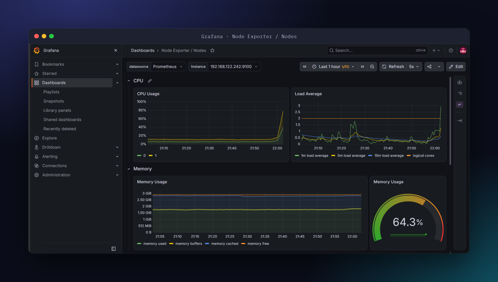
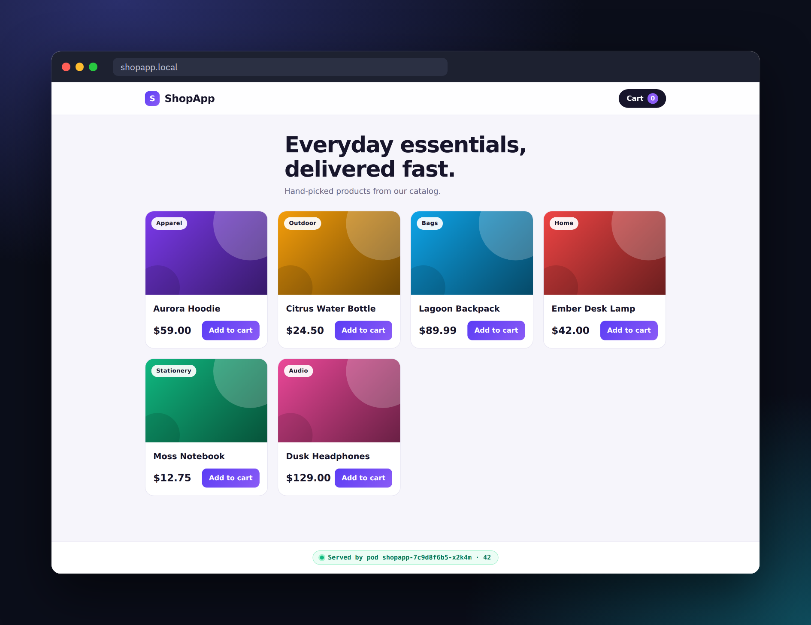
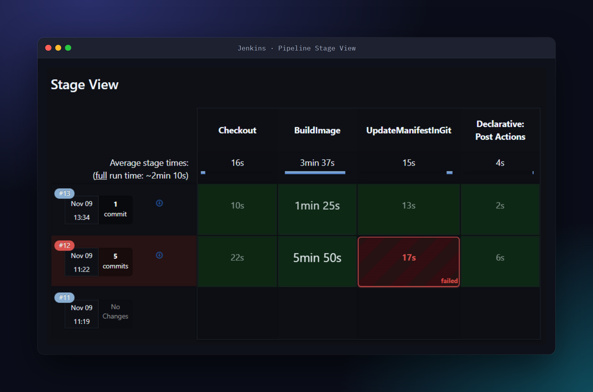
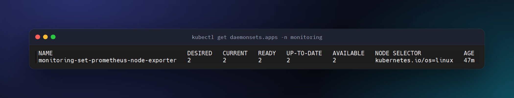

<div align="center">

# Kubernetes GitOps Platform

**A kubeadm cluster, CI host and GitOps delivery pipeline, built from bare VMs on one laptop and fully codified in Ansible.**

[](https://moaz-elgendy.github.io/kubeadm-project/)


</div>

## At a glance

- Two KVM VMs on a single Debian 13 laptop (i5-3230M, 8 GB RAM) run a real **Kubernetes v1.35.9** cluster bootstrapped with kubeadm, containerd and Flannel.
- The cluster and the CI host (Jenkins, Docker, Trivy) are codified in **8 reusable Ansible roles** (two playbooks rebuild everything).
- **0 manual `kubectl apply` per release**: Jenkins builds and pushes the image, commits the new tag to Git, and Argo CD rolls it out.
- About **1.5 minutes from commit to image** (average full CI run: 1 min 36 s), with a Trivy scan on every build.
- Full-stack monitoring with kube-prometheus-stack, with **node-exporter on every node** and Grafana dashboards.
- A real app (Node.js, Express, MySQL 8.4 StatefulSet) with probes, resource limits, a NetworkPolicy and a ResourceQuota.

## Architecture


A push to `main` fires a GitHub webhook. Jenkins on the server checks out the code, builds the image, scans it with Trivy, pushes `mk0230/shopapp:<BUILD_NUMBER>` to Docker Hub, then commits the new tag to `k8s/app/deployment.yaml` with `[ci skip]`. Argo CD watches `k8s/app` on `main` and syncs the change into the cluster. Jenkins never touches the cluster; Git is the only source of truth. Prometheus scrapes every node and Grafana visualises it.

## Screenshots

| | |
|---|---|
| <br>Grafana, Node Exporter dashboard for the worker | <br>The shopapp storefront |
| <br>Jenkins stage view: a failed build, then green | <br>Both nodes Ready on v1.35.9 |
| <br>Monitoring pods spread over both nodes | <br>node-exporter DaemonSet, 2/2 |

## How it works

### Infrastructure as code

Details in [`ansible/README.md`](ansible/README.md). Versions and addresses live in `ansible/group_vars/`.

| Playbook | Roles, in order | What happens |
|---|---|---|
| `k8s-setup.yml` | `apt-upgrade` | Patch all nodes, reboot only if required |
| | `k8s-cluster-creation` (+ `k8s-common`) | OS prep, containerd (SystemdCgroup), kubeadm init, Flannel v0.28.10 |
| | `kubectl` | Checksum-verified kubectl v1.35.9 on the control plane |
| | `k8s-cluster-join` (+ `k8s-common`) | Join the worker, create the MySQL PV directory |
| | label and taint tasks | Worker gets `project=shopapp` and `workload=shopapp:NoSchedule` |
| `jenkins-setup.yml` | `apt-upgrade`, `jenkins`, `docker`, `trivy` | CI host: Java 21 + Jenkins LTS, Docker, Trivy |

### CI (Jenkins)

[`jenkins/Jenkinsfile`](jenkins/Jenkinsfile) runs three stages on the built-in node, triggered by the GitHub push webhook:

1. **Checkout** a clean workspace.
2. **BuildImage** (`buildApp`): docker build, non-blocking Trivy scan (HIGH and CRITICAL, HTML report archived), push to Docker Hub.
3. **UpdateManifestInGit** (`pushGithub`): rewrite the image tag in `k8s/app/deployment.yaml`, commit and push to `main`.

Both steps are a shared library in [`jenkins/vars/`](jenkins/vars). Every stage has `not { changelog '.*\\[ci skip\\].*' }`, and the manifest commit message ends in `[ci skip]`, so the pipeline cannot trigger itself.

### CD (Argo CD)

[`k8s/argocd/application.yaml`](k8s/argocd/application.yaml) points Argo CD at `k8s/app` on `main` with `automated` sync, `selfHeal: true` and `prune: true`. Manual drift in the cluster is reverted; objects removed from Git are removed from the cluster.

### Kubernetes workload

All manifests in [`k8s/app/`](k8s/app) are assembled by `kustomization.yaml`.

| Object | Name | Purpose |
|---|---|---|
| Namespace | `shopapp` | Isolation for the app |
| ResourceQuota | `shopapp-quota` | Caps pods at 4 (3 steady + 1 rolling-update surge) |
| ConfigMap | `shopapp-config` | `DB_HOST`, `DB_USER`, `DB_NAME` |
| StorageClass, PersistentVolume | `local-storage`, `shopapp-mysql-pv` | Local storage pinned to the worker (`/mnt/mysql-data`) |
| StatefulSet + headless Service | `shopapp-db` | MySQL 8.4 with a 5Gi volumeClaimTemplate |
| Deployment | `shopapp` | 2 replicas, init container waits for MySQL, `/health` and `/ready` probes, non-root, 200m/500Mi requests |
| Service | `shopapp` | ClusterIP on port 3000 |
| NetworkPolicy | `shopapp-db-allow-app` | Only `app=shopapp` pods may reach MySQL on 3306 |
| Secret | `shopapp-db-secret` | Created with kubectl, never committed ([`secret.example.yaml`](k8s/app/secret.example.yaml) is a template) |

### Monitoring

[`k8s/monitoring/values.yaml`](k8s/monitoring/values.yaml) configures the `kube-prometheus-stack` Helm chart (Prometheus, Operator, Grafana, Alertmanager, kube-state-metrics). node-exporter runs as a DaemonSet, one pod per node, scraped at `<node-ip>:9100`. Every component gets a `NoSchedule` toleration so it runs on both the tainted worker and the control plane.

## Repository layout

```text
.
├── app/                    # Node.js storefront, Dockerfile, docker-compose.yml (local dev)
├── ansible/
│   ├── ansible.cfg
│   ├── inventory/hosts.ini
│   ├── group_vars/         # all.yml, k8s_cluster.yml
│   ├── k8s-setup.yml       # cluster playbook
│   ├── jenkins-setup.yml   # CI host playbook
│   └── roles/              # apt-upgrade, k8s-common, k8s-cluster-creation, k8s-cluster-join,
│                           # kubectl, jenkins, docker, trivy
├── jenkins/
│   ├── Jenkinsfile
│   └── vars/               # shared library: buildApp.groovy, pushGithub.groovy
├── k8s/
│   ├── app/                # shopapp manifests + kustomization (Argo CD source path)
│   ├── argocd/application.yaml
│   └── monitoring/values.yaml
└── docs/                   # GitHub Pages showcase: index.html + assets/
```

## Run it yourself

**Prerequisites:** a Debian 13 host with libvirt/KVM, two Debian 13 VMs (`192.168.122.69` control plane, `192.168.122.242` worker), the host's SSH key authorised for `debian@` on both, Ansible with `community.general` and `ansible.posix`. Adjust `ansible/inventory/hosts.ini` to your addresses.

1. Build the cluster and the CI host:
   ```bash
   cd ansible
   ansible-playbook k8s-setup.yml
   ansible-playbook jenkins-setup.yml -K
   ```
2. On the control plane, install Argo CD (pinned):
   ```bash
   kubectl create namespace argocd
   kubectl apply -n argocd --server-side -f https://raw.githubusercontent.com/argoproj/argo-cd/v3.6.1/manifests/install.yaml
   ```
3. Create the app namespace and its secret (never committed):
   ```bash
   kubectl create namespace shopapp
   kubectl -n shopapp create secret generic shopapp-db-secret \
     --from-literal=DB_PASSWORD=... --from-literal=MYSQL_ROOT_PASSWORD=...
   ```
4. Hand the app to Argo CD:
   ```bash
   kubectl apply -f k8s/argocd/application.yaml
   ```
5. Install monitoring:
   ```bash
   helm repo add prometheus-community https://prometheus-community.github.io/helm-charts
   helm upgrade --install monitoring prometheus-community/kube-prometheus-stack --version 92.17.0 -n monitoring --create-namespace -f k8s/monitoring/values.yaml
   ```
6. Configure Jenkins:
   - Credentials: `docker-hub` (Docker Hub user and token) and `github` (user and PAT with push access).
   - Manage Jenkins, System, Global Trusted Pipeline Libraries: name `shared-lib`, this repo, library path `jenkins/`.
   - Pipeline job from SCM with script path `jenkins/Jenkinsfile`.
   - GitHub webhook to `http://<jenkins-host>:8080/github-webhook/`.

Local development without a cluster: `cd app && docker compose up --build`.

## Troubleshooting highlights

| Problem | Root cause | Fix |
|---|---|---|
| App stuck in `Init:0/1`, Argo CD `Degraded` | `DB_HOST` in the ConfigMap named a Service that did not exist; the init wait loop hid the DNS error | Point `DB_HOST` at the headless Service `shopapp-db`. The ConfigMap now lives in the Argo-managed path, so fixes go through Git |
| Rolling update pod `Pending`: `0/2 nodes are available: 1 Insufficient cpu` | Requests of 1 CPU/1Gi per pod on a 2 vCPU, ~2.9 GiB worker | Requests 200m/500Mi, limits 1 CPU/1Gi, quota raised from 3 to 4 pods |
| Pipeline could trigger itself through its own manifest commit | The push to `main` fired the webhook again | `[ci skip]` in the commit message plus a `changelog` condition on every stage |

## Skills demonstrated

- **Kubernetes:** kubeadm bootstrap, CNI, taints, tolerations, StatefulSets, local PVs, NetworkPolicy, quotas, probes, rolling updates.
- **Infrastructure as code:** idempotent Ansible roles, pinned versions, checksum-verified binaries, shared group variables.
- **CI/CD and GitOps:** declarative Jenkins pipeline, shared library, Argo CD auto-sync, build-loop prevention.
- **Security:** Trivy image scanning, non-root containers, secrets kept out of Git, database reachable only from app pods (NetworkPolicy).
- **Observability:** kube-prometheus-stack, node-exporter DaemonSet, Grafana dashboards.
- **Linux and virtualization:** KVM/libvirt NAT networking, containerd, systemd services, SSH and socat access paths.

## Author

**Moaz Elgendy** · [GitHub](https://github.com/Moaz-Elgendy)
